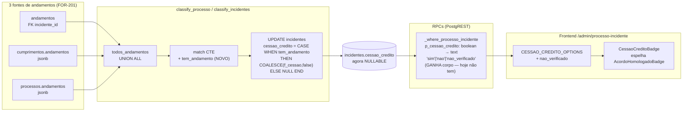

# Architecture: FOR-202 — cessao_credito sem estado "não verificado"

## Visão de alto nível

**Antes:** `incidentes.cessao_credito boolean NOT NULL DEFAULT false`. `classify_processo`/
`classify_incidentes` sempre gravam `true`/`false`, mesmo quando o incidente nunca teve
nenhum andamento pra conferir. O filtro `p_cessao_credito` nas RPCs existe na assinatura
mas não filtra nada (bug pré-existente, achado nesta investigação).

**Depois:** `incidentes.cessao_credito boolean NULL` — `NULL` = nunca verificado (sem
nenhum andamento em nenhuma das 3 fontes), `true`/`false` = verificado de verdade. Mesmo
padrão de `djen_depre.acordo_homologado`. Filtro de 3 estados funcionando de fato.

## Componentes impactados

| Arquivo | Mudança |
|---|---|
| `sql/2026-10-21_for202_cessao_credito_nullable.sql` (novo) | Schema: `DROP NOT NULL`/`DROP DEFAULT`. `CREATE OR REPLACE` de `classify_processo`/`classify_incidentes` com `tem_andamento`. |
| `sql/2026-10-21_for202_backfill_cessao_credito.sql` (novo) | Backfill em lotes, cursor por `id`, recálculo ao vivo. Script separado da migration de schema — roda depois, sob supervisão, não dentro de uma transação única. |
| `sql/2026-10-21_for202_rpcs_cessao_credito_enum.sql` (novo) | `DROP FUNCTION` + `CREATE OR REPLACE` das 3 RPCs com `p_cessao_credito text`. |
| `sql/sandbox/for202_validate_local.sh` (novo) | Validação local antes de produção, mesmo molde do `for201_validate_local.sh`. |
| `frontend/src/lib/api/processos.ts` | `cessaoCredito?: boolean\|null` → `"sim"\|"nao"\|"nao_verificado"\|null`; `cessao_credito: boolean` (row) → `boolean\|null`. |
| `frontend/src/routes/admin.processo-incidente.tsx` | `CESSAO_CREDITO_OPTIONS` +`nao_verificado`; `oneOf(...)` do search validator; conversão do filtro (não mais `=== "sim"` direto pra boolean); novo componente `CessaoCreditoBadge` (mirror de `AcordoHomologadoBadge`); CSV export. |
| `frontend/src/routes/admin.processo-incidente.for160.test.ts` + `.oneof.for160.test.ts` | Ajustar asserções que assumem `cessao_credito` 2-estado. |
| `frontend/src/lib/api/processos.for160.test.ts` | Idem. |

**Não mexe em:** `resultado-fase.tsx`, `admin.leads.tsx`, `novo-lead-avulso-dialog.tsx` —
já tratam `cessao_credito` como tri-state (`formatTriEstado`/`InfoRiscoLinha`), decisão
deliberada de code review anterior (FOR-161) que até agora era só defensiva (a coluna
nunca mandava `null` de verdade) e passa a refletir a realidade sem precisar de mudança
de código ali.

## Convenções mantidas

- Mesmo padrão exato de `acordo_homologado` (nullable boolean, enum `'sim'|'nao'|
  'nao_verificado'` no filtro) — zero padrão novo introduzido.
- `DROP FUNCTION` explícito nas 3 RPCs antes do `CREATE OR REPLACE` (mesma cautela do
  FOR-160/FOR-189 — mudança de tipo de parâmetro é mudança de assinatura).
- Migrations numeradas por data, com cabeçalho explicando contexto/decisão (convenção do
  repo, ver qualquer arquivo em `sql/`).

## Trade-offs e alternativas consideradas (e descartadas)

| Alternativa | Por que não |
|---|---|
| Coluna `cessao_credito_verificado_em timestamptz` separada | Mais informação do que foi pedido (ninguém perguntou "quando", só "se"). Dobra a superfície de mudança sem ganho. |
| Enum de texto em vez de boolean nullable | Já são exatamente 3 estados — boolean nullable já expressa isso; enum não ganha nada e diverge do padrão dos outros 7 flags da mesma função (todos boolean). |
| Resolver a mesma lacuna nos outros 6 flags nesta mesma issue | Fora do pedido explícito do dono do produto. Registrado como follow-up (ver abaixo) — a ambiguidade neles é real e se propaga pra `fase`/`macrofase`/`elegivel`, mas é decisão de escopo, não technical debt ignorado sem registro. |
| Backfill numa transação única | Tabela sob escrita contínua do crawler em produção — lock longo demais, trava o worker. Lotes por cursor de `id` evitam isso. |

## Limitações e premissas

- Premissa: o worker-crawler (deployado no FOR-201) já está rodando o código que persiste
  `cumprimentos.andamentos`/`processos.andamentos` — confirmado em produção (checado
  nesta mesma sessão de trabalho mais ampla, não nesta sub-sessão de fleet).
- Limitação aceita: há uma janela de corrida entre o backfill rodar e o crawler
  reclassificar o mesmo incidente concorrentemente — mitigada (não eliminada
  completamente) recalculando "sem andamento" ao vivo dentro de cada UPDATE do backfill,
  em vez de usar uma lista pré-computada.
- Limitação aceita (fora de escopo): os outros 6 flags continuam com a ambiguidade
  false-ou-nunca-verificado.

## Consequências adversas

- Durante a janela entre o backfill terminar e o deploy do frontend, a UI antiga (que
  ainda faz `r.cessao_credito ? "Sim" : "Não"`) vai mostrar "Não" para os ~200k incidentes
  que viraram `NULL` — enganoso, mas temporário. Mitigação: aplicar backfill e deployar
  frontend o mais próximo possível um do outro, nessa ordem.
- Qualquer código externo (fora deste repo/frontend) que já consome `cessao_credito` como
  boolean estrito (ex.: export de dados, planilha, integração futura) vai precisar tratar
  `null` explicitamente. Não identificado nenhum consumidor desse tipo nesta investigação.

## Fora de escopo — follow-up a registrar no Linear

1. **Mesma ambiguidade nos outros 6 flags** (`calculo_homologado`, `incidente_instaurado`,
   `termo_declaracao`, `oficio_deferido`, `oficio_expedido`, `ordem_cronologica`,
   `possivelmente_pago`) e propagação pra `fase`/`macrofase`/`elegivel`. Decisão de
   escopo do dono do produto, não esquecimento — mas precisa de issue própria se for
   endereçado depois.
2. **Duplicação de ~115 linhas** entre `classify_processo` e `classify_incidentes` (CTE +
   UPDATE idênticos, só o filtro WHERE muda). Achado do revisor especialista: ao atacar o
   item 1 acima, vale extrair a lógica compartilhada antes de repetir o fix 2x.

---

## ✅ Verificação de Consistência

**Data**: 2026-10-21
**Status**: ✅ APROVADO

### Checklist
- [x] context.md e architecture.md consistentes (mesmo escopo, mesma causa raiz, mesmos
      5 pontos de mudança)
- [x] Conforme decisão de produto do usuário (nullable boolean, não timestamp/enum; só
      `cessao_credito`, não os outros 6 flags)
- [x] Conforme padrões do projeto (mesmo padrão de `acordo_homologado`, mesma convenção
      de migrations numeradas, mesmo `DROP FUNCTION` explícito)
- [x] Revisão de especialista (database-architect) incorporada integralmente ao plano

### Notas
Nenhuma correção necessária — o context.md já incorporava a revisão do especialista
(feita antes desta sub-sessão de fleet, na conversa principal) antes deste arquivo ser
escrito, então não houve divergência a reconciliar.
